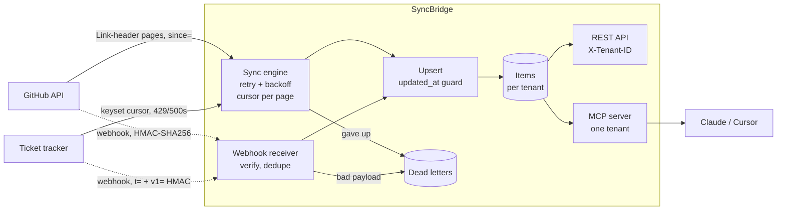

# SyncBridge

**One place to see a customer's work items across their tools, kept fresh, safe to share with AI agents.**

A customer's engineering work lives in GitHub, a ticket tracker, and more. SyncBridge connects to each tool,
keeps a normalized copy in sync (polling plus webhooks), and exposes it through a tenant-scoped REST API and an
**MCP server**, so Claude or Cursor can answer "what P0s are open for Acme?" without touching the source systems.

## Verified results

| Check | Result |
|---|---|
| Full sync from a tracker returning random 500s and 429s | 250/250 items, 10 pages |
| Re-sync with nothing changed | 1 item read, 0 writes |
| One issue changed upstream, incremental sync | 2 items read, 1 write |
| Upstream outage mid-sync | 100 items kept, dead letter created; replay resumed at page 3, not page 1 |
| Live sync of `pallets/click` on GitHub (since Sep 1, 2026) | 151 issues/PRs, 2 pages; re-sync wrote nothing |
| Duplicate webhook delivery / forged signature / stale timestamp | ignored / 401 / 401 |
| Older event arriving after a newer one | newer version kept |
| Tenant B queries tenant A's data (REST and MCP) | empty / 404 |
| MCP server driven by a real MCP client over stdio | 3 tools listed, search returns live GitHub data |
| Test suite | 19 passed |

## Architecture



## Design decisions

- **Correctness comes from the upsert, not from delivery guarantees.** Each item is keyed by `(connection, source_id)`
  and only overwritten by a strictly newer `updated_at`. Re-reads, duplicate webhooks and out-of-order events
  therefore do nothing, so every other component is allowed to retry freely.
- **The cursor is committed with each page.** If a sync fails, the next run resumes from the last stored page.
  GitHub's `since` is inclusive, so one item is re-read each run; the upsert guard makes that harmless.
- **Errors are classified.** 429 (using `Retry-After`), 5xx, network errors and GitHub's
  `403 + X-RateLimit-Remaining: 0` are retried with backoff. Other 4xx (bad token, missing repo) fail at once,
  because retrying won't fix them.
- **Nothing is dropped silently.** Syncs that give up and webhooks that can't be parsed go to a dead-letter table
  with the error, and can be replayed (`POST /dlq/{id}/replay`) after the fix.
- **Webhooks are verified before parsing.** Constant-time HMAC comparison; the tracker signature includes a timestamp
  so replays older than 5 minutes are rejected. A malformed but authentic payload returns 202 and is dead-lettered,
  so the sender doesn't retry it forever.
- **Tenant isolation everywhere.** Every query filters by tenant, other tenants' resources return 404 (not 403), and
  the MCP server is pinned to one tenant through `SYNCBRIDGE_TENANT`; the agent can't choose another.
- **Adding a source = one class.** A connector implements `fetch_page`, `verify_webhook`, `parse_webhook` and maps to
  `NormalizedItem`. See `app/connectors/github.py` (~90 lines).

## Run it

```bash
uv venv --python 3.12 && source .venv/bin/activate
uv pip install -r requirements-dev.txt
pytest -q

# Flaky mock tracker + API, then the scripted demo
TRACKER_FAILURE_RATE=0.15 TRACKER_RATE_LIMIT_PER_SEC=5 uvicorn mock_tracker.main:app --port 9200 &
uvicorn app.main:app --port 8200 &
./scripts/demo.sh
```

Or `docker compose up` (Postgres + mock tracker + API on :8000).

Connect a real GitHub repo:

```bash
curl -X POST localhost:8200/connections -H "X-Tenant-ID: acme" -H "Content-Type: application/json" \
  -d '{"provider":"github","name":"click","config":{"owner":"pallets","repo":"click","since":"2026-09-01T00:00:00Z"}}'
curl -X POST localhost:8200/connections/1/sync -H "X-Tenant-ID: acme"
```

Use it from Claude Desktop or Cursor (MCP config):

```json
{
  "mcpServers": {
    "syncbridge": {
      "command": "/abs/path/syncbridge/.venv/bin/python",
      "args": ["-m", "app.mcp_server"],
      "cwd": "/abs/path/syncbridge",
      "env": {"DATABASE_URL": "sqlite:////abs/path/syncbridge/syncbridge.db", "SYNCBRIDGE_TENANT": "acme"}
    }
  }
}
```

Check it without an editor: `SYNCBRIDGE_TENANT=acme python scripts/mcp_check.py "login"`.

## API

| Method | Path | Notes |
|---|---|---|
| POST | `/connections` | Returns the webhook secret once |
| GET | `/connections` | Status, last success, last error |
| POST | `/connections/{id}/sync` | Incremental sync |
| POST | `/webhooks/{id}` | Authenticated by signature, not tenant header |
| GET | `/items?q=&status=&assignee=` | Newest first |
| GET | `/items/{id}` | |
| GET | `/dlq`, POST `/dlq/{id}/replay` | |

All endpoints except webhooks and `/health` require `X-Tenant-ID`.

## What I'd do before a real customer rollout

- Run syncs in a worker queue (Celery/RQ) with a per-connection lock; today a sync runs inside the request and two
  concurrent syncs of one connection aren't prevented.
- Move tokens and webhook secrets to a secrets manager; they are stored in the database in plain text here.
- Detect deletions (webhook `deleted` events, periodic full reconciliation); polling alone can't see them.
- Replace `LIKE` search with Postgres full-text or `pg_trgm`, and add Alembic migrations.
- Real auth (API keys or OIDC) mapped to tenants instead of a trusted `X-Tenant-ID` header.
- Metrics: sync lag per connection, retry and dead-letter rates, alerts when a connection stays in `error`.
